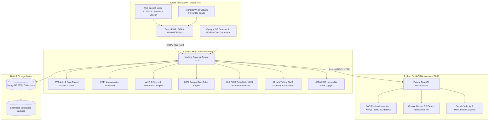

# MamaCare+ Kenya 🇰🇪
### AI-Powered Smart Motherhood & Infant Monitoring System

MamaCare+ is an integrated digital health companion and Mother and Child Health (MCH) booklet companion designed for first-time mothers in Kenya, in full alignment with the **Ministry of Health (MoH Kenya)**, **Kenya Expanded Programme on Immunization (KEPI)**, **WHO Child Growth Standards**, and the **Kenya Data Protection Act, 2019 (KDPA)**.

---

## 1. Hybrid Design Philosophy
**The system does NOT replace paper records.** In accordance with national legal and clinical standards:
- Physical **MoH 216 paper booklets** remain the official legal primary record.
- The digital system runs alongside it with a **"Verified against paper booklet"** audit flag and page number reference for each vaccination, visit, and measurement.
- Printable MoH 216 booklet summary with scannable opaque QR stickers for physical booklet covers.
- Ensures a seamless, trust-preserving digital transition across Kenyan health facilities (Dispensaries, Health Centres, Sub-County Hospitals, and Referral Facilities like Pumwani and KNH).

---

## 2. System Architecture Overview & Mermaid Diagram



---

## 3. Monorepo Folder Structure

```text
mamacare-kenya/
├── ai-service/                   # Python FastAPI AI Microservice
│   ├── Dockerfile
│   ├── requirements.txt
│   └── main.py                   # RAG, emergency triage & growth faltering
├── server/                       # Backend Services, Schemas, & Interoperability
│   ├── models/
│   │   └── schemas.ts            # Complete Mongoose schemas with indexes (20 entities)
│   ├── services/
│   │   ├── kepiScheduler.ts      # KEPI schedule generator & catch-up logic
│   │   ├── growthStandards.ts    # WHO z-score anthropometrics & Kenyan nutrition
│   │   ├── emergencyDetection.ts # IMCI danger signs & Kenyan referral hotlines
│   │   ├── aiAssistantService.ts # Gemini API + MoH RAG retriever + safety checks
│   │   ├── smsProvider.ts        # Africa's Talking SMS provider & simulator
│   │   └── fhirInteroperability.ts # HL7 FHIR R4 & MoH CSV export layer
│   └── tests/
│       └── schedulerAndGrowth.test.ts # Automated test suite
├── src/                          # Mobile-First React PWA Client
│   ├── components/
│   │   ├── TopNav.tsx            # Top bar contract & role/child selector
│   │   ├── BottomNav.tsx         # Mobile thumb navigation (44px hitboxes)
│   │   ├── DashboardView.tsx     # Child overview & paper booklet sync badge
│   │   ├── VaccinationView.tsx   # KEPI schedule, batch entry, SMS reminders
│   │   ├── GrowthView.tsx        # Recharts WHO percentile curves & milestones
│   │   ├── AiAssistantView.tsx   # Bilingual Swahili/English voice chatbot
│   │   ├── MaternalHealthView.tsx# ANC visits, PNC, EPDS depression test & journal
│   │   ├── ClinicianPortalView.tsx# Doctor/nurse patient chart & QR lookup
│   │   ├── PaperBookletPrintView.tsx # Printable MoH 216 & QR sticker format
│   │   ├── EducationView.tsx     # MoH Kenya articles with audio narration
│   │   ├── AnalyticsView.tsx     # Facility KPIs, defaulters list & KDPA export
│   │   ├── EmergencyModal.tsx    # High-visibility danger triage & SOS SMS
│   │   └── AddChildModal.tsx     # Register child / twins / multiple birth
│   ├── types.ts                  # Shared TypeScript interfaces
│   ├── App.tsx                   # Main state & view routing shell
│   ├── main.tsx
│   └── index.css                 # Tailwind CSS v4 styling & print CSS
├── server.ts                     # Full-stack entry point (Express + Vite middleware)
├── docker-compose.yml            # Multi-container deployment orchestrator
├── package.json
└── README.md
```

---

## 4. REST API Specification

### Authentication & Users
- `GET /api/auth/me?role={mother|clinician|admin}`: Current session credentials & permissions.
- `POST /api/auth/switch-role`: Instant role switching for evaluation and clinic simulation.

### Children & Multi-Child Management
- `GET /api/children`: List children registered to the logged-in user or clinic.
- `POST /api/children`: Add child (name, DOB, sex, birth weight, birth length, facility, multiple birth group, paper booklet serial).
- `GET /api/children/:id`: Detailed record bundle (demographics, vaccines, growth, visits).

### Immunization (KEPI)
- `GET /api/children/:id/vaccinations`: Child schedule generated from DOB with statuses (`upcoming`, `due`, `overdue`, `completed`).
- `POST /api/children/:id/vaccinations/:recId/administer`: Administer dose with batch number, facility, and `verifiedAgainstPaperBooklet` flag.

### WHO Growth & Nutrition
- `GET /api/children/:id/growth`: Anthropometric history with calculated WHO z-scores (WAZ, HAZ, BMI).
- `POST /api/children/:id/growth`: Record new weight, length, head circumference, and MUAC.

### AI Assistant & Emergency Triage
- `POST /api/ai/chat`: Context-aware conversational guidance with deterministic danger sign pre-screening, MoH Kenya RAG corpus, and Gemini API synthesis.
- `POST /api/emergency/trigger`: Dispatch high-priority SOS alert with automated Africa's Talking SMS to emergency contacts and referral facility.

### Interoperability & Export
- `GET /api/children/:id/fhir`: HL7 FHIR R4 Bundle (`Patient`, `Immunization`, `Observation`).
- `GET /api/children/:id/moh-csv`: CSV format for DHIS2 / Kenya Health Information System (KHIS).
- `GET /api/backup/export`: Encrypted JSON portability dump compliant with Section 26 of KDPA 2019.

---

## 5. Quickstart & Deployment

### Local Development
```bash
# 1. Install dependencies
npm install

# 2. Launch full-stack Express + Vite dev server
npm run dev
# App will run at http://localhost:3000
```

### Docker Compose (Full Stack with MongoDB & Python AI Microservice)
```bash
docker-compose up --build
```

### Run Automated Unit Tests
```bash
npx tsx server/tests/schedulerAndGrowth.test.ts
```
